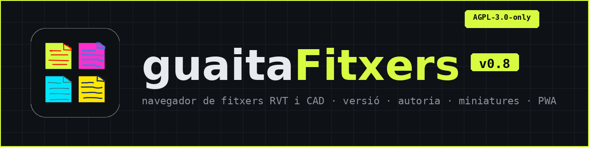

<!-- SPDX-License-Identifier: AGPL-3.0-only · Copyright (c) 2026 SBS BiM Consulting, Jordi Subirós -->
<p align="center"></p>

<p align="center">


</p>

<p align="center"><b>🇨🇦 <a href="#català">Català</a></b> · <b>🇬🇧 <a href="#english">English</a></b></p>

---

## Català

**Guaita Fitxers** és un navegador de fitxers **RVT i CAD** que funciona íntegrament al navegador. Llegeix la versió RVT, el primer i el darrer editor, el nombre de desats i les miniatures directament del fitxer, i permet gestionar-los com ho faries a l'explorador del sistema. No envia cap dada a cap servidor. Forma part de la suite **Guaita Apps**.

### Instal·la-la com a aplicació (PWA)

**PWA** vol dir *aplicació web progressiva*: instal·la Guaita Fitxers a l'ordinador i s'obre en finestra pròpia. Després de la primera càrrega, funciona sense connexió.

- **Chrome / Edge:** icona d'instal·lar a la barra d'adreces, o menú ⋮ / ··· → «Instal·la Guaita Fitxers».
- Cal servir-la per HTTPS (p. ex. GitHub Pages). En obrir el fitxer en local (`file://`) funciona com a pàgina normal, però no s'instal·la i el pont no hi té accés.

### Funcions

| | |
|---|---|
| 🏷 **Versió i autoria** | Versió de RVT, primer i darrer editor, nombre de desats i historial complet |
| 🖼 **Miniatures** | Visualització ampliada, descàrrega en PNG i substitució per una imatge pròpia (amb còpia `.bak`) |
| ⧉ **Còpies RVT** | Agrupa les còpies `NOM.0040.rvt` sota el fitxer principal, amb el nombre i les dates |
| 📄 **Formats** | RVT, RFA, RTE, RFT, DWG, IFC, PDF, DXF, E57, OBJ, glTF, GLB, 3DM, BCF, HTML i imatges |
| 🗂 **Gestió de fitxers** | Copiar, moure, reanomenar i esborrar, amb arrossegament entre carpetes, desfer i registre |
| 📤 **Safata de fitxers** | Enviament a la safata compartida de la suite Guaita quan corre dins del launcher |
| ⛭ **Pont amb RVT** | Opcional (Windows): obre fitxers amb la versió RVT triada i els localitza a l'Explorador |

### Fitxers

| Fitxer | Ús |
|---|---|
| `app/guaitaFitxers.html` | L'aplicació (un sol fitxer, versió 0.8.1, interfície en català) |
| `manifest.webmanifest`, `sw.js`, `icons/` | Instal·lació com a PWA i ús sense connexió; **han d'estar a l'arrel** |
| `bridge/guaita_fitxers.py` | Pont local opcional amb RVT (Python) |
| `pageCAT/index.html`, `pageCAT/ajuda.html` | Landing i manual en català |
| `pagesENG/index.html`, `pagesENG/help.html` | Landing i manual en anglès |
| `images/` | Imatges de presentació |

### Ús

1. Obre `app/guaitaFitxers.html` (o la landing de [`pageCAT/index.html`](pageCAT/index.html)).
2. Prem **Obre una carpeta** i tria la carpeta arrel.
3. Filtra, ordena i gestiona els fitxers. Per obrir-los amb RVT, vegeu el pont més avall.

📘 **Manual complet:** [`pageCAT/ajuda.html`](pageCAT/ajuda.html)

### Pont amb RVT (opcional, Windows)

Un HTML no pot obrir programes ni l'Explorador pel seu compte. El pont és un petit programa Python que s'executa al teu equip:

```
pip install olefile                 # obligatori
pip install pillow pywin32          # opcional: edició de miniatures (només Windows)
python bridge/guaita_fitxers.py "E:\ENTREGUES"
```

El pont escolta només a `127.0.0.1` i **només accepta peticions** des de `https://subi2.github.io` i des de `localhost`. Només opera sobre fitxers RVT (`.rvt .rfa .rte .rft`). Qualsevol altra web que intenti fer-hi peticions és rebutjada amb un error 403.

### Limitacions conegudes

- Requereix un navegador basat en Chromium (Chrome o Edge) per a totes les funcions. En altres navegadors només funciona la selecció manual de fitxers en mode lectura.
- Les funcions de RVT (versions instal·lades, obrir i localitzar) només funcionen amb el pont actiu i a Windows.
- Els fitxers molt grans (núvols de punts, OBJ) es llegeixen només fins als primers 2 MB; els recomptes d'aquests casos es marquen com a **mostra**.
- L'esborrat és **definitiu**: no va a la paperera de reciclatge.
- No és una eina per a l'anàlisi forense ni per certificar l'autoria de cap fitxer: les dades llegides són les que conté el fitxer.

### Contribuir

Les contribucions són benvingudes. Abans d'enviar una pull request, cal acceptar el [CLA v1.0](https://github.com/subi2/guaitaPDF/blob/main/CLA.md) (Acord de Llicència de Contribuïdor) i incloure la línia `Signed-off-by` a cada commit.

### Components i llicència

Pont: [olefile](https://olefile.readthedocs.io/) (BSD) · [Pillow](https://python-pillow.org/) (HPND, opcional).

Programari lliure sota la [GNU Affero General Public License v3.0 (AGPL-3.0-only)](LICENSE). © 2026 Jordi Subirós · SBS BiM Consulting.

---

## English

**Guaita Fitxers** is a **RVT and CAD** file browser that runs entirely in the browser. It reads the RVT version, the first and last editor, the number of saves and thumbnails directly from the file, and lets you manage files the way you would in the system file explorer. It does not send any data to a server. It is part of the **Guaita Apps** suite.

### Install it as an app (PWA)

**PWA** means *progressive web app*: install Guaita Fitxers on your computer and it opens in its own window. After the first load, it works offline.

- **Chrome / Edge:** install icon in the address bar, or ⋮ / ··· menu → “Install Guaita Fitxers”.
- Serve it over HTTPS (e.g. GitHub Pages). Opened locally (`file://`) it works as a normal page, but cannot be installed and the bridge cannot reach it.

### Features

| | |
|---|---|
| 🏷 **Version and authorship** | RVT version, first and last editor, number of saves and full history |
| 🖼 **Thumbnails** | Enlarged view, PNG download and replacement with your own image (with a `.bak` copy) |
| ⧉ **RVT backups** | Groups `NAME.0040.rvt` backups under their main file, with the count and dates |
| 📄 **Formats** | RVT, RFA, RTE, RFT, DWG, IFC, PDF, DXF, E57, OBJ, glTF, GLB, 3DM, BCF, HTML and images |
| 🗂 **File management** | Copy, move, rename and delete, with drag and drop between folders, undo and a log |
| 📤 **File tray** | Send files to the shared Guaita tray when running inside the launcher |
| ⛭ **Bridge to RVT** | Optional (Windows): open files with the chosen RVT version and locate them in Explorer |

### Files

| File | Use |
|---|---|
| `app/guaitaFitxers.html` | The application (single file, version 0.8.1, Catalan interface) |
| `manifest.webmanifest`, `sw.js`, `icons/` | PWA install and offline use; **must be at the root** |
| `bridge/guaita_fitxers.py` | Optional local Python bridge to RVT |
| `pageCAT/index.html`, `pageCAT/ajuda.html` | Catalan landing and manual |
| `pagesENG/index.html`, `pagesENG/help.html` | English landing and manual |
| `images/` | Presentation images |

### Usage

1. Open `app/guaitaFitxers.html` (or the landing page [`pagesENG/index.html`](pagesENG/index.html)).
2. Press **Open a folder** and choose the root folder.
3. Filter, sort and manage the files. To open them with RVT, see the bridge below.

📘 **Full guide:** [`pagesENG/help.html`](pagesENG/help.html)

### Bridge to RVT (optional, Windows)

An HTML page cannot open programs or Explorer on its own. The bridge is a small Python program that runs on your computer:

```
pip install olefile                 # required
pip install pillow pywin32          # optional: thumbnail editing (Windows only)
python bridge/guaita_fitxers.py "E:\ENTREGUES"
```

The bridge listens only on `127.0.0.1` and **only accepts requests** from `https://subi2.github.io` and from `localhost`. It only operates on RVT files (`.rvt .rfa .rte .rft`). Any other website trying to reach it is rejected with a 403 error.

### Known limitations

- Requires a Chromium-based browser (Chrome or Edge) for all features. In other browsers only manual file selection in read-only mode works.
- RVT features (installed versions, opening and locating files) only work with the bridge running and on Windows.
- Very large files (point clouds, OBJ) are read only up to the first 2 MB; their counts are marked as **sample**.
- Deletion is **permanent**: it does not go to the recycle bin.
- Not a forensic tool and not a way to certify the authorship of any file: the data read is what the file contains.

### Contributing

Contributions are welcome. Before opening a pull request, please accept the [CLA v1.0](https://github.com/subi2/guaitaPDF/blob/main/CLA.md) (Contributor License Agreement) and add a `Signed-off-by` line to each commit.

### Components and licence

Bridge: [olefile](https://olefile.readthedocs.io/) (BSD) · [Pillow](https://python-pillow.org/) (HPND, optional).

Free software under the [GNU Affero General Public License v3.0 (AGPL-3.0-only)](LICENSE). © 2026 Jordi Subirós · SBS BiM Consulting.

---

> Guaita Apps es distribueix «tal com és», sense cap garantia. / Guaita Apps is distributed “as is”, without any warranty.
